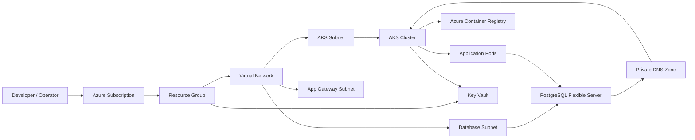

# Azure AKS Infrastructure

This project provisions a secure Azure Kubernetes Service (AKS) environment with networking, private PostgreSQL, Azure Container Registry (ACR), and Key Vault using Terraform.

## Architecture

The infrastructure includes:

- Azure Resource Group
- Virtual Network and subnets
- AKS cluster
- Azure Container Registry
- PostgreSQL Flexible Server in a private subnet
- Private DNS zone for PostgreSQL
- Key Vault for secrets and identity-related configuration

### Architecture diagram



### Terraform resource relationship graph

```mermaid
flowchart TD
    A[azurerm_resource_group.main] --> B[module.networking]
    A --> C[module.dns]
    A --> D[module.database]
    A --> E[module.aks]
    A --> F[module.keyvault]
    A --> G[module.acr]

    B --> B1[azurerm_virtual_network.main]
    B --> B2[azurerm_subnet.aks]
    B --> B3[azurerm_subnet.database]
    B --> B4[azurerm_subnet.appgw]
    B --> B5[azurerm_network_security_group.aks-subnet-nsg]
    B --> B6[azurerm_network_security_group.database]

    C --> C1[azurerm_private_dns_zone.postgres]
    C --> C2[azurerm_private_dns_zone_virtual_network_link.postgres]

    D --> D1[azurerm_postgresql_flexible_server.primary]
    D --> D2[azurerm_postgresql_flexible_server_database.db]
    D --> D3[azurerm_postgresql_flexible_server_configuration.*]
    D --> D4[random_password.postgres_password]

    E --> E1[azurerm_user_assigned_identity.aks]
    E --> E2[azurerm_user_assigned_identity.kubelet]
    E --> E3[azurerm_role_assignment.network_contributor]
    E --> E4[azurerm_role_assignment.managed_identity_operator]
    E --> E5[azurerm_kubernetes_cluster.aks]

    F --> F1[random_string.kv_suffix]
    F --> F2[azurerm_key_vault.kv]

    G --> G1[random_string.acr_suffix]
    G --> G2[azurerm_container_registry.acr]
    G --> G3[azurerm_role_assignment.aks_acr_pull]

    E5 --> ACR
    E5 --> PG
    E5 --> KV
    PG --> DNS
```



## Project structure

```text
.
├── main.tf
├── providers.tf
├── variables.tf
├── terraform.tfvars
├── modules/
│   ├── aks/
│   ├── acr/
│   ├── database/
│   ├── dns/
│   ├── keyvault/
│   ├── networking/
│   └── compute/
├── usefull-commands.sh
└── README.md
```

## Prerequisites

Before deploying, make sure you have:

- Azure CLI installed and authenticated
- Terraform installed
- Access to an Azure subscription with permission to create the required resources

Login to Azure:

```bash
az login
az account set --subscription "<subscription-id-or-name>"
```

## Configuration

Update the values in `terraform.tfvars` before running Terraform.

Example:

```hcl
subscription_id = "<subscription-id>"
resource_group_name = "azure-vijay-rg"
location            = "westus"
environment         = "dev"

vnet_name              = "azure-vijay-vnet"
vnet_address_space     = "10.0.0.0/16"
aks_subnet_prefix      = "10.0.1.0/24"
database_subnet_prefix = "10.0.2.0/24"
appgw_subnet_prefix    = "10.0.4.0/24"

aks_cluster_name = "azure-vijay-aks"
aks_dns_prefix   = "azure-vijay-aks"
aks_node_count   = 2
aks_vm_size      = "Standard_D2s_v4"

acr_name = "azurevijayacr"

postgres_sku_name   = "B_Standard_B2s"
postgres_version    = "16"
postgres_storage_mb = 32768
postgres_db_name    = "appdb"
```

## Terraform workflow

Initialize the working directory:

```bash
terraform init
```

Validate the configuration:

```bash
terraform validate
```

Review the deployment plan:

```bash
terraform plan
```

Apply the infrastructure:

```bash
terraform apply
```

Destroy resources when no longer needed:

```bash
terraform destroy
```

## Azure resource notes

### AKS

The AKS cluster uses a user-assigned managed identity and kubelet identity.

### Database

The PostgreSQL Flexible Server is created with:

- private access enabled
- VNet integration via the delegated database subnet
- private DNS integration
- generated administrator password

### Registry

The ACR module configures the Azure Container Registry and grants the AKS kubelet identity access for pulling images.

## Accessing the database from AKS

Because the PostgreSQL server is private, applications running inside the AKS cluster can connect using the private FQDN and credentials created by Terraform.

Typical connection pattern:

```bash
psql "host=<db-fqdn> user=psqladmin password=<password> dbname=appdb sslmode=require"
```

## Useful commands

Authenticate with Azure:

```bash
az login
az account set --subscription "<subscription-id>"
```

Get AKS credentials:

```bash
az aks get-credentials --resource-group <resource-group> --name <aks-cluster-name> --overwrite-existing
```

Check cluster nodes and workloads:

```bash
kubectl get nodes
kubectl get pods -A
```

## Notes

- Some Azure regions may impose quota or service restrictions, so choose a supported region from your subscription.
- For production workloads, store PostgreSQL and other sensitive secrets in Key Vault or Kubernetes Secrets rather than hardcoding them.
- The current setup is intended for a private, VNet-integrated environment rather than public database access.

## License

This project is for infrastructure demonstration and learning purposes.
